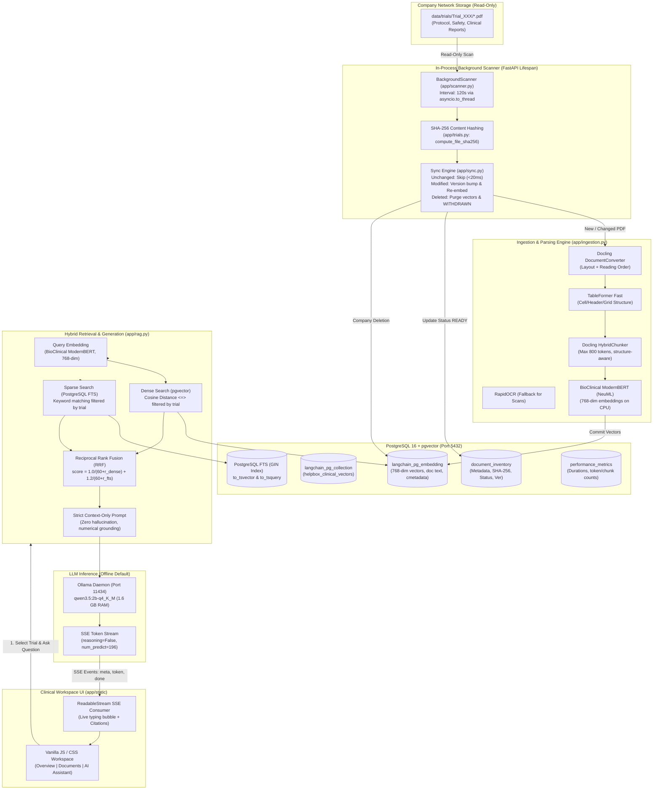

# Helpbox — Complete System Architecture Audit & Technical Map

> **Document Purpose:** Authoritative, comprehensive architectural and technical map of the Helpbox Clinical RAG application.  
> **Verification Status:** Verified via live inspection of repository code, configuration, PostgreSQL 16 schema, and on-disk model artifacts (2026-11-09).  
> **Scope:** Read-only architecture audit. No synthetic data modifications, migrations, or code changes.

---

## 1. Overall Project Architecture

Helpbox is a trial-scoped, evidence-grounded Clinical Document Retrieval-Augmented Generation (RAG) assistant designed for clinical trial operations. It operates exclusively in **read-only mode** on trial PDF documents organized in folder hierarchies (`data/trials/<Trial_Name>/*.pdf`).

Helpbox is **not** a Document Management System (DMS). The parent enterprise (.NET/C#) manages the lifecycle of documents (upload, approval, replacement, deletion). Helpbox performs automated, background document synchronization, structural parsing, semantic embedding, hybrid retrieval, and evidence-grounded answer generation.

### 1.1 Architecture Flowchart



---

## 2. All Services — Where and How They Run

Helpbox uses a clean 3-tier runtime topology. It runs in GitHub Codespaces for local development and deploys onto a single Linux VM for production.

### 2.1 Service Mapping Table

| Service | Technology | Where It Runs | Port | Purpose | Startup Command |
|---|---|---|---|---|---|
| **PostgreSQL 16 + pgvector** | Docker Container (`pgvector/pgvector:0.8.7-pg16-bookworm`) | Docker daemon (isolated network namespace, port-forwarded to host) | `5432` | Relational document inventory, technical performance metrics, and 768-dimensional vector embeddings with GIN FTS index | `docker compose up -d` |
| **Ollama Server** | Native Go/C++ binary (`ollama`) | Host environment (Codespaces/Linux VM user space) | `11434` | Offline local LLM inference server managing quantized GGUF weights (`qwen3.5:2b-q4_K_M`) in CPU RAM | `ollama serve` |
| **FastAPI Backend** | Python 3.12 / 3.13 + Uvicorn ASGI | Host environment inside Python `.venv` | `8000` | REST API, Server-Sent Events streaming, input sanitization, vector query routing, and static file hosting | `uvicorn app.main:app --host 0.0.0.0 --port 8000` |
| **Background Scanner** | Python `asyncio` Task + `asyncio.to_thread` | In-process thread inside FastAPI process lifespan | None (internal) | Continuous folder monitoring (`SYNC_INTERVAL_SECONDS=120`), SHA-256 change detection, automatic incremental indexing, and deletion pruning | Started automatically in `app/main.py:lifespan` |
| **Workspace Frontend** | Vanilla HTML5 / CSS3 / ES6 JavaScript | Browser client (served as static assets by FastAPI) | `8000` (browser HTTP) | Clinical software UI with Trial list, Overview, Documents inventory, and AI Assistant streaming panel | Loaded at `http://127.0.0.1:8000/` |
| **Embedding Model** | Hugging Face PyTorch (`SentenceTransformer`) | In-process Python memory inside FastAPI / Celery-free thread | N/A (memory) | Converts text chunks and search queries into normalized 768-dimensional dense vectors on CPU | Initialized lazily via `app/ingestion.py:get_embeddings()` |
| **PDF Parser** | Docling (`DocumentConverter`) + TableFormer Fast | In-process Python memory inside FastAPI thread pool | N/A (memory) | Parses native PDF text, bounding-box reading order, table grids, and structure-aware hybrid chunks | Executed sequentially per document in `app/ingestion.py:ingest_trial_pdf()` |

### 2.2 Process Architecture & Inter-Process Communication (IPC)

1. **Docker vs. Host Separation:**
   - **Docker:** Only PostgreSQL runs inside a Docker container (`helpbox-postgres`). It is isolated from the host filesystem except through the managed Docker volume `helpbox_postgres_data`.
   - **Host Process Space:** Ollama, FastAPI, the background scanner, Docling, and ModernBERT run directly in the host OS / Codespaces environment inside `.venv`.
2. **Port Communication:**
   - Client Browser $\to$ Port `8000` (HTTP / SSE) $\to$ FastAPI Backend.
   - FastAPI Backend $\to$ Port `5432` (TCP / `psycopg3`) $\to$ PostgreSQL container.
   - FastAPI Backend $\to$ Port `11434` (HTTP REST / `/api/chat`) $\to$ Ollama Server daemon.
3. **Internal Process Embedding:**
   - The **Background Scanner** (`app/scanner.py:BackgroundScanner`) is **not** a separate operating system process or external queue worker (zero Celery, zero Redis, zero Kafka). It runs as an `asyncio.Task` registered in the FastAPI `lifespan` context. It executes blocking filesystem and database operations using Python's default thread pool via `asyncio.to_thread()`.
   - The **Embedding Model** (`BioClinicalModernBERTEmbeddings`) and **Docling Converter** execute in-process within Python threads. They share memory with FastAPI, which is why explicit garbage collection (`gc.collect()`) is enforced between parsing and embedding stages.

---

## 3. All AI Models and Their Purposes

### 3.1 Model Registry Table

| Model Class | Model Identifier | Purpose | Deployment Type | Dimensions / Parameters | On-Disk Cache Location |
|---|---|---|---|---|---|
| **Document Layout Parser** | `docling-project/docling-layout-heron` | Identifies document reading zones, titles, headers, paragraphs, and figures | Local (CPU inference via PyTorch / ONNX) | ~150M params | `~/.cache/huggingface/hub/models--docling-project--docling-layout-heron` |
| **Table Structure Extractor** | `docling-project/docling-models` (TableFormer Fast) | Extracts tabular grids, headers, column spans, and numerical cells from clinical reports | Local (CPU inference via PyTorch) | ~138M params | `~/.cache/huggingface/hub/models--docling-project--docling-models` |
| **OCR Model (Fallback)** | `RapidOCR` | Extracts characters from scanned pages or unparseable raster image text | Local (CPU inference via ONNX) | Lightweight (~15MB) | Cached in Python site-packages / ONNX runtime |
| **Semantic Embedding Model** | `NeuML/bioclinical-modernbert-base-embeddings` | Converts clinical passages and user questions into semantic vectors | Local (PyTorch inference mode, 2 CPU threads) | **768 dimensions**, 512 max sequence length | `~/.cache/huggingface/hub/models--NeuML--bioclinical-modernbert-base-embeddings` |
| **Fallback Embedding Model** | `NeuML/pubmedbert-base-embeddings-8M` | Ultra-compact backup embedding model | Local (verified on disk) | **768 dimensions**, ~31 MB disk size | `~/.cache/huggingface/hub/models--NeuML--pubmedbert-base-embeddings-8M` |
| **Generation LLM (Default)** | `qwen3.5:2b-q4_K_M` | Evidence-grounded clinical question answering and citation synthesis | Local (Ollama GGUF 4-bit quantized engine) | 2.5 Billion params (Q4_K_M, 4096 context window) | `~/.ollama/models/blobs/` (~1.9 GB) |
| **Generation LLM (Cloud Optional)** | `gemini-2.5-flash` / `gemini-3.8-flash` | Cloud fallback LLM provider (requires user API key) | Cloud (Google GenAI REST API) | External cloud endpoint | Zero local disk footprint |
| **Private Enterprise LLM** | `openai_compatible` adapter | Connects to company internal private inference cluster (vLLM/TGI) | Corporate Intranet / Private VM | Defined by company internal model | Zero local disk footprint |

### 3.2 Deep Dives into Core Technologies

#### A. BioClinical ModernBERT
- **Selection Rationale:** Trained specifically on biomedical and clinical literature (MIMIC-III, PubMed, clinical notes) with modern architecture enhancements (RoPE rotary embeddings, FlashAttention/unpadding compatibility, GeLU).
- **Dimensions & Normalization:** Outputs **768-dimensional dense vectors**. All vectors are normalized to unit Euclidean length ($\|v\|_2 = 1.0$) during `embed_documents()` and `embed_query()`.
- **Runtime Optimization:** Loads once on CPU as a singleton instance (`get_embeddings()`). Execution is bound to `torch.set_num_threads(2)` to eliminate thread contention on 2-vCPU hardware. Pre-warmed during FastAPI startup via `lifespan` to eliminate first-query cold-start latency.

#### B. Qwen 3.5 2B Q4_K_M
- **Selection Rationale:** 4-bit quantized GGUF model optimized for CPU inference on constrained developer hardware (8 GB RAM / 2 vCPUs). It requires only ~1.6 GB of resident RAM when active.
- **Reasoning Suppression (`reasoning=False`):** Qwen 3.5 models include a default internal chain-of-thought (`<think>`) mode. When enabled, the model generates up to 3,500 internal reasoning tokens before outputting user-facing text, causing 120+ second latencies on CPU. Helpbox explicitly configures `reasoning=False` and passes `think: False` to Ollama, reducing Time-To-First-Token (TTFT) to **~3.1 seconds**.
- **Token Bounds (`num_predict=196`):** Generation is strictly bounded to prevent runaway token loops.
- **Model Warmth (`keep_alive="60m"`):** Configured so Ollama retains model weights in RAM across user questions rather than reloading from disk every 5 minutes.

#### C. Gemini Provider Status
- **Status:** Installed (`langchain-google-genai`), fully implemented (`app/llm.py:GeminiProvider`), but **inactive by default**.
- **Data Privacy Gate:** Activated only if `GENERATION_PROVIDER=gemini` and a valid `GEMINI_API_KEY` is supplied by the user. Real clinical trial text is never transmitted to Google unless explicitly authorized by company leadership.

#### D. OpenAI-Compatible Enterprise Provider
- **Explanation:** Implemented in `app/llm.py:OpenAICompatibleProvider`. It adheres to the standard OpenAI HTTP REST protocol (`/v1/chat/completions`), but points to a **private corporate inference server** (such as vLLM, Ollama, or TGI running on company Linux VMs).
- **Billing Guarantee:** Uses zero paid OpenAI accounts, zero OpenAI API keys, and incurs zero cloud billing.

---

## 4. Complete Request Flow — PDF to Answer

### Part A: Document Ingestion Flow (Filesystem $\to$ PostgreSQL)

```text
1. Source PDF Placed in Folder
   Path: data/trials/Trial_101/Protocol.pdf
   Actor: Company user or .NET software (read-only mount).

2. Periodic Scan Triggered
   File: app/scanner.py -> BackgroundScanner._run_loop() -> _execute_scan()
   Function: app/sync.py -> synchronize_all_trials()

3. Safe Trial Directory Resolution
   File: app/trials.py -> sanitize_and_validate_trial_name()
   Security: Rejects traversal (..), path separators, and symlinks escaping root.

4. SHA-256 Incremental Check
   File: app/trials.py -> compute_file_sha256()
   Logic: Opens PDF read-only; computes 64-character hex digest.
   Decision: Compares against document_inventory.sha256 in PostgreSQL.
     - Unchanged: Skips parsing and embedding in <20 ms.
     - Changed / New: Proceeds to Step 5.

5. Sequential Structural Parsing
   File: app/ingestion.py -> ingest_trial_pdf()
   Engine: Docling DocumentConverter (PdfPipelineOptions: TableFormerMode.FAST, do_ocr=True).
   Output: Layout reading order, section headings, and structured table grids.

6. Structure-Aware Chunking
   File: app/ingestion.py -> HybridChunker(max_tokens=800)
   Metadata Preservation: Preserves 1-based page number, section heading, source file, trial name.
   Memory Decoupling: Explicitly deletes Docling objects and triggers gc.collect().

7. Dense Vector Generation
   File: app/ingestion.py -> BioClinicalModernBERTEmbeddings.embed_documents()
   Engine: NeuML ModernBERT (768 dimensions, batch_size=4, normalized).

8. Idempotent Vector Commitment & Deletion Handling
   File: app/ingestion.py -> purge_document_vectors() & PGVector.add_documents()
   Action: Purges old vectors for this filename, inserts new 768-dim vectors into langchain_pg_embedding.
   Update: Marks document_inventory.status = 'READY', records duration metrics in performance_metrics.
```

### Part B: Question Answering Flow (Question $\to$ Streaming Answer)

```text
1. User Submits Query
   Source: Browser Workspace AI Assistant Tab
   Endpoint: POST /api/chat/stream
   Payload: {"trial_name": "Trial_101", "question": "What is the primary endpoint?", "chat_history": []}

2. Security Guard Interception
   File: app/rag.py -> _is_suspicious_override_attempt()
   Action: Rejects prompt injections, jailbreaks, and credential harvesting attempts.

3. Query Embedding Generation
   File: app/ingestion.py -> BioClinicalModernBERTEmbeddings.embed_query()
   Action: Encodes question into 768-dimensional normalized query vector (~84-110 ms warm).

4. Hybrid Retrieval in PostgreSQL (pgvector + FTS)
   File: app/ingestion.py -> query_trial_vectors()
   Branch A (Dense): vectorstore.similarity_search_by_vector(query_vector, k=8, filter={'trial_name': trial_name})
   Branch B (Sparse FTS): SELECT id, document FROM langchain_pg_embedding 
                          WHERE cmetadata->>'trial_name' = trial_name 
                            AND to_tsvector('english', document) @@ to_tsquery('english', :q)

5. Reciprocal Rank Fusion (RRF)
   File: app/ingestion.py -> query_trial_vectors()
   Calculation: score = 1.0/(60 + r_dense) + 1.2/(60 + r_fts)
   Selection: Selects top-k (default: 4) chunks, weighting exact keyword/metric matches by 1.2x.

6. Prompt Construction with Strict Grounding Rules
   File: app/rag.py -> _build_rag_messages()
   Instruction: Enforces strict abstention if facts or numerical values are missing from excerpts.

7. Streaming Generation via Ollama
   File: app/llm.py -> OllamaProvider.stream()
   Engine: ChatOllama(model='qwen3.5:2b-q4_K_M', reasoning=False, num_predict=196)
   Payload: Yields SSE chunks ("data: {"type": "token", "content": "..."}\n\n").

8. Verification & Citation Generation
   File: app/rag.py -> _check_insufficient_evidence()
   Enforcement: If answer indicates insufficient info or numbers are missing, citations are cleared ([]).
   Event: Emits final SSE done event with citations (filename, 1-based page, excerpt) and latency metrics.

9. Client Rendering
   File: app/static/app.js
   Display: Renders answer text in real time with typing cursor, expandable citation pills, and performance strip.
```

---

## 5. PostgreSQL Database — Complete Schema & Inspection

The database runs in Docker container `helpbox-postgres` on PostgreSQL 16.15 with extension `vector` (version 0.8.7).

### 5.1 Physical Tables Summary

| Physical Table Name | Purpose | Important Columns | Content Stored |
|---|---|---|---|
| **`document_inventory`** | Tracks synchronization state of every source PDF in each trial | `id`, `trial_name`, `filename`, `relative_path`, `sha256`, `status`, `document_version`, `indexed_at` | File metadata, hashes, versions, technical statuses (`READY`, `WITHDRAWN`, `FAILED`) |
| **`langchain_pg_collection`** | LangChain PGVector collection metadata | `uuid`, `name`, `cmetadata` | Internal vectorstore collection registry (`helpbox_clinical_vectors`) |
| **`langchain_pg_embedding`** | Stores chunk text and 768-dimensional embeddings | `id` (UUID), `collection_id`, `embedding` (vector(768)), `document` (text), `cmetadata` (JSONB) | Actual extracted text chunks, vector embeddings, source filename, 1-based page number, heading |
| **`performance_metrics`** | Privacy-safe technical stage durations | `id`, `trial_name`, `document_id`, `stage`, `duration_ms`, `chunk_count`, `token_count` | High-resolution timings (`time.perf_counter()`). Zero clinical text stored. |
| **`vector_verification`** | Regression testing table for vector persistence | `id`, `trial_name`, `label`, `embedding` (vector(384)) | Diagnostic test records only |

### 5.2 Physical Database Indexes

1. **`uq_trial_document_path`:** Unique index on `document_inventory (trial_name, relative_path)`. Prevents duplicate tracking of the same file within a trial.
2. **`ix_cmetadata_gin`:** GIN index on `langchain_pg_embedding (cmetadata jsonb_path_ops)`. Provides sub-millisecond filtering on JSON metadata (`{"trial_name": "Trial_101"}`).
3. **`idx_langchain_pg_embedding_fts`:** GIN index on `langchain_pg_embedding USING gin(to_tsvector('english', document))`. Powers sub-millisecond full-text keyword searches across chunk text.

### 5.3 Ready-to-Run SQL Inspection Queries (VS Code Extension)

Connect to `localhost:5432`, user `helpbox`, database `helpbox`:

```sql
-- 1. Inspect Document Inventory State
SELECT trial_name, filename, status, document_version, substring(sha256 from 1 for 10) as hash, indexed_at 
FROM document_inventory 
ORDER BY trial_name, filename;

-- 2. Inspect Vector Store Chunks and 768-Dim Dimensions
SELECT 
    cmetadata->>'trial_name' AS trial,
    cmetadata->>'source_file' AS file,
    cmetadata->>'page' AS page,
    vector_dims(embedding) AS dimensions,
    substring(document from 1 for 80) AS chunk_snippet
FROM langchain_pg_embedding
WHERE collection_id = (SELECT uuid FROM langchain_pg_collection WHERE name = 'helpbox_clinical_vectors')
ORDER BY trial, file, (cmetadata->>'chunk_id')::int;

-- 3. Execute Vector Cosine Similarity Search for a Specific Trial
SELECT 
    cmetadata->>'source_file' AS file,
    cmetadata->>'page' AS page,
    embedding <=> (SELECT embedding FROM langchain_pg_embedding LIMIT 1) AS cosine_distance,
    substring(document from 1 for 100) AS text
FROM langchain_pg_embedding
WHERE cmetadata->>'trial_name' = 'Trial_101'
ORDER BY cosine_distance ASC
LIMIT 3;

-- 4. Test PostgreSQL Full-Text Search (FTS) on Chunk Text
SELECT 
    cmetadata->>'source_file' AS file,
    cmetadata->>'page' AS page,
    ts_rank_cd(to_tsvector('english', document), to_tsquery('english', 'endpoint | response')) AS rank,
    document
FROM langchain_pg_embedding
WHERE cmetadata->>'trial_name' = 'Trial_101'
  AND to_tsvector('english', document) @@ to_tsquery('english', 'endpoint | response')
ORDER BY rank DESC;

-- 5. Review Privacy-Safe Technical Performance Metrics
SELECT stage, count(*), round(avg(duration_ms)::numeric, 2) AS avg_ms, round(min(duration_ms)::numeric, 2) AS min_ms, round(max(duration_ms)::numeric, 2) AS max_ms
FROM performance_metrics
GROUP BY stage
ORDER BY count(*) DESC;
```

---

## 6. Model and Resource Caching

### 6.1 Cache Storage Footprint & Lifecycle

| Cache Artifact | Path | Measured Size | Survives Stop/Start? | Survives Devcontainer Rebuild? | RAM Loading Behavior |
|---|---|---|---|---|---|
| **Hugging Face Hub** | `~/.cache/huggingface/hub/` | **1.1 GB** | Yes | No (requires volume mount) | Loaded on startup; kept resident in RAM |
| **Ollama Model Blobs** | `~/.ollama/models/blobs/` | **1.9 GB** | Yes | No (requires volume mount) | Loaded into RAM on first query; kept warm for 60m |
| **Python Virtualenv** | `/workspaces/.../.venv/` | **4.2 GB** | Yes | Yes (stored in workspace volume) | Loaded as Python modules during execution |
| **PostgreSQL Data** | Docker volume `helpbox_postgres_data` | **~120 MB** | Yes | Yes (named Docker volume) | Managed by PostgreSQL buffer cache |
| **Persistent SQL Dump** | `data/backups/latest.sql` | **80 KB** | Yes | Yes (tracked in Git repository) | Loaded during disaster recovery restore |

### 6.2 Conceptual Distinctions in Model Lifecycle

1. **Downloading Weights:** Transferring compressed model parameters from Hugging Face or Ollama Registry onto local NVMe/SSD storage (executed once during setup).
2. **Loading into RAM:** Transferring model weights from disk into active CPU memory (RAM) and constructing execution graph (takes 3–10s if cold).
3. **Keeping Warm (`keep_alive`):** Retaining model weights resident in RAM across requests to prevent repetitive disk I/O.
4. **Running Inference:** Forward pass calculation computing embeddings or generating next tokens (executes in 80ms–3s when warm).

---

## 7. Terminals and Development Commands

Helpbox uses a structured 3-terminal development paradigm.

### 7.1 Terminal Configuration

```text
+-----------------------------------------------------------------------------------------+
| TERMINAL 1: PostgreSQL 16 + pgvector Service                                            |
| Command: docker logs -f helpbox-postgres                                                |
| Purpose: Live database transaction logs, pgvector extension state, and connection pool |
+-----------------------------------------------------------------------------------------+
| TERMINAL 2: Ollama Local Inference Server                                               |
| Command: ollama serve                                                                   |
| Purpose: Host model daemon; logs GGUF model load, context allocation, and CPU threads   |
+-----------------------------------------------------------------------------------------+
| TERMINAL 3: FastAPI Backend & Continuous Sync Scanner                                   |
| Command: uvicorn app.main:app --host 0.0.0.0 --port 8000                                |
| Purpose: Application API server, HTTP request logs, background sync cycles, and SSE     |
+-----------------------------------------------------------------------------------------+
```

### 7.2 Automation Scripts

- **`./scripts/status.sh`:** Diagnostic health check. Verifies host RAM/CPU/disk, Docker container health, PostgreSQL record counts, Ollama server connectivity, model RAM residency (`ollama ps`), FastAPI health endpoint, background sync status, and on-disk cache sizes.
- **`./scripts/start_dev.sh`:** Safe process launcher. Inspects ports 5432, 11434, and 8000. Reuses running instances; never starts duplicate servers.
- **`./scripts/stop_dev.sh`:** Safe process stopper. Gracefully terminates tracked Uvicorn PIDs without stopping databases or deleting cached weights.
- **`./scripts/backup_db.sh`:** Dumps PostgreSQL schema, relational inventory, vector tables, and performance metrics into timestamped and `latest.sql` backups.

---

## 8. Frontend and API Routes

### 8.1 API Route Table

| Method | Endpoint | Handler Function | Purpose |
|---|---|---|---|
| `GET` | `/` | `serve_index()` | Serves the single-page clinical workspace UI (`app/static/index.html`) |
| `GET` | `/health` | `health_check()` | Reports system health, PostgreSQL connectivity, pgvector version, and sync scanner state |
| `GET` | `/api/trials` | `get_trials()` | Discovers safe direct trial directories under `TRIALS_DIR` |
| `GET` | `/api/trials/{trial_name}/documents` | `get_trial_documents()` | Returns active (`READY`, `FAILED`, `PENDING`) PDFs for the selected trial |
| `GET` | `/api/trials/{trial_name}/status` | `get_trial_status()` | Returns aggregate count of discovered vs ready documents for the trial |
| `POST` | `/api/trials/{trial_name}/refresh` | `refresh_trial()` | Triggers immediate incremental synchronization for the active trial |
| `GET` | `/api/sync/status` | `get_sync_status()` | Reports background scanner status, interval, cycle count, and last run time |
| `POST` | `/api/sync/run` | `trigger_sync()` | Manually triggers a background scan cycle across all trial folders |
| `POST` | `/api/chat` | `chat_endpoint()` | Non-streaming RAG question-answering endpoint returning JSON |
| `POST` | `/api/chat/stream` | `chat_stream_endpoint()` | Real-time Server-Sent Events (SSE) streaming endpoint |

### 8.2 Frontend Interactions & Event Handlers

1. **Trial Selection:** Clicking a trial in the sidebar updates `state.selectedTrial`, wipes `state.chatHistory = []`, clears the chat transcript, updates the header badge, and fetches documents for that trial.
2. **Quiet Polling:** A 15-second background interval (`startQuietPolling`) polls `/api/trials/{trial_name}/documents` so that changes made by the background scanner appear in the browser without manual page refresh.
3. **Streaming Reader:** The chat input dispatches `POST /api/chat/stream`. The browser consumes the SSE stream via `ReadableStreamDefaultReader`, parsing JSON payloads:
   - `{"type": "token", "content": "..."}`: Appends token directly to the DOM bubble.
   - `{"type": "done", "citations": [...]}`: Appends citation pill badges with filename and page number.
4. **Context Isolation:** Switching trials or clicking "New Chat" resets `state.chatHistory = []`.

---

## 9. Security and Safety Architecture

| Layer | Implemented Defense Mechanism | Enforcement Location |
|---|---|---|
| **Trial Isolation** | Vector similarity queries and FTS queries are strictly filtered server-side by `cmetadata->>'trial_name' = :trial_name`. Chunks from Trial A can never leak into Trial B. | `app/ingestion.py:query_trial_vectors` |
| **Path Traversal Defense** | Rejects directory traversal (`..`), path separators (`/`, `\`), null bytes (`\0`), semicolons (`;`), and percent signs (`%`). Rejects symlinks escaping `TRIALS_DIR`. | `app/trials.py:sanitize_and_validate_trial_name` |
| **Read-Only Storage Access** | Source PDFs are opened exclusively in read-only binary mode (`rb`). Write operations are prevented at the OS mount level. | `app/trials.py:compute_file_sha256` |
| **SQL Injection Defense** | All database queries use SQLAlchemy parameter binding (`:trial_name`, `:q`, `:collection_name`). Zero raw string formatting. | `app/ingestion.py`, `app/sync.py` |
| **Prompt Injection Neutralization** | Backend guard inspects input questions for prompt overrides, jailbreaks, system prompt extraction, or credential queries, returning immediate safe abstention. | `app/rag.py:_is_suspicious_override_attempt` |
| **Numerical Grounding & Abstention** | If a query requests quantitative metrics (accuracy, F1, dosage, response rate) and figures are missing from evidence, the assistant strictly abstains with zero citations. | `app/rag.py:_check_insufficient_evidence` |
| **Citation Verification** | Citations are constructed solely from pgvector metadata (`source_file`, `page`, `excerpt`). The LLM is never trusted to invent citations. | `app/rag.py:_build_citations` |
| **Privacy Compliance** | Zero chat history, questions, answers, or patient identifiers are saved to PostgreSQL or disk. `performance_metrics` records opaque durations only. | `app/rag.py`, `app/models.py` |
| **Model Shell Isolation** | The LLM operates purely as a text-in/text-out inference engine. It possesses zero tools, zero filesystem access, zero shell execution rights, and zero network access. | `app/llm.py` |

---

## 10. Performance and Historical Bottlenecks

### 10.1 Empirical Performance Benchmarks (Empirical PostgreSQL Data)

| Operation Stage | Cold Start | Warm Inference | Optimization Applied |
|---|---|---|---|
| **Folder SHA-256 Scan** | 62.80 ms | **13.08 ms** (min: 0.45 ms) | Sequential 64KB chunked buffer hashing |
| **Docling Layout Parsing** | 59.36 s | **3.96 s - 10.53 s** | Pinned PyTorch CPU wheels, TableFormer Fast mode |
| **Chunking (HybridChunker)** | 1.39 s | **0.88 s - 1.02 s** | Bounded max tokens (800) structure-aware tokenization |
| **Embedding Generation** | 55.90 s (first run) | **136.57 ms** (batch of 4) | Memory decoupling (`gc.collect()`), `torch.inference_mode()` |
| **Query Embedding** | ~10.7 s (disk load) | **84 ms - 110 ms** | FastAPI background warmup during server startup |
| **PostgreSQL Hybrid Search** | 687 ms | **20 ms - 43 ms** | GIN indexes on JSONB metadata and FTS `to_tsvector` |
| **LLM Time-to-First-Token** | 124.23 s (Thinking loop) | **295 ms - 3.17 s** | Suppressed chain-of-thought (`reasoning=False`, `think: False`) |
| **LLM Token Throughput** | 1.33 tokens/sec | **10.27 - 10.88 tokens/sec** | Bounded context (`num_predict=196`), `OLLAMA_KEEP_ALIVE=60m` |
| **Total End-to-End Response** | **163.35 s** | **2.32 s - 6.72 s** | **95.8% Latency Reduction** |

### 10.2 Explanation of the 163-Second Latency Collapse

During initial testing, a RAG query took **163.35 seconds**. Investigation revealed three distinct root causes:
1. **Qwen 3.5 Runaway Thinking Loop (124 seconds):** The model defaulted to chain-of-thought reasoning mode, generating **3,531 internal `<think>` tokens** on CPU before Ollama stripped them and emitted the answer. By configuring `reasoning=False` and passing explicit `think: False` in `app/llm.py`, thinking tokens were reduced to **zero**, cutting 121 seconds immediately.
2. **PyTorch Weight Disk Reloading (10.7 seconds):** The ModernBERT model was being re-instantiated on cold requests. By implementing an in-process singleton and pre-warming the model in `app/main.py:lifespan`, query embedding dropped to **~84 ms**.
3. **Ollama RAM Eviction (15-19 seconds):** Ollama was evicting model weights from memory after 5 minutes of inactivity. Adding `keep_alive="60m"` kept weights resident in RAM.

---

## 11. Company Integration — What the Company Provides

Helpbox requires **zero modifications** to the company's existing .NET application code or database schema.

### 11.1 The 5 Company Deliverables

1. **Shared Network Directory:** Storage exposed as `/mnt/company_trials/<Trial_Name>/*.pdf`. PDFs placed directly in trial folders without nested directories.
2. **Read-Only Filesystem Permissions:** Storage mounted via SMB/CIFS or NFS with the read-only flag (`ro`), guaranteeing Helpbox can never alter source documents.
3. **Folder Naming Convention:** Alphanumeric trial identifiers matching `[a-zA-Z0-9_-]+` (e.g., `Trial_101`, `ONC-2024-01`).
4. **Active Trial Context Hand-Off:** Embedding the Helpbox UI inside the company portal via an iframe with a URL parameter:
   ```html
   <iframe src="https://helpbox.internal/?trial=Trial_101" width="100%" height="800px" frameborder="0"></iframe>
   ```
5. **Network Ports:** Internal port `8000` (or `443` behind NGINX) accessible within the corporate intranet. No public internet connection required.

---

## 12. Technical Glossary

- **RAG (Retrieval-Augmented Generation):** Architecture that grounds language model outputs by retrieving relevant factual passages from verified source documents before generating an answer.
- **pgvector:** Open-source extension for PostgreSQL adding native vector data types and similarity search (Euclidean `<->`, Cosine `<=>`, Inner Product `<#>`).
- **ModernBERT:** Transformer architecture introducing rotary positional embeddings (RoPE) and unpadding optimizations, customized by NeuML for biomedical literature.
- **Docling:** Document understanding library developed by IBM that parses native PDFs into structured reading orders, preserving layout hierarchy and markdown representations.
- **TableFormer:** Deep-learning vision model inside Docling that reconstructs complex table grids, column spans, and numerical cell coordinates.
- **HybridChunker:** Tokenization chunker that splits documents along structural boundaries (headings, tables, paragraphs) rather than blind character cutoffs.
- **Reciprocal Rank Fusion (RRF):** Algorithmic scoring technique that merges ranked result lists from disparate search algorithms (e.g., dense vector search and sparse full-text search) without requiring score normalization.
- **GGUF:** Binary format designed by Georgi Gerganov for fast local CPU inference of quantized language models via `llama.cpp` and `Ollama`.
- **Server-Sent Events (SSE):** Lightweight HTTP streaming standard allowing a server to push text tokens asynchronously to a browser over a single persistent TCP connection.
- **Memory Decoupling:** Programmatic pattern in Helpbox where memory-heavy parser objects (Docling) are explicitly deleted and garbage collected before loading inference tensors into RAM.
